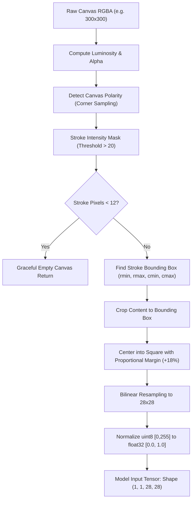

# STAGE 3: INTERACTIVE DRAWING RECOGNITION PROTOTYPE — VALIDATION REPORT

**Project:** Draw to Survive: An AI-Powered Drawing Adventure  
**Objective:** Interactive Drawing Recognition Prototype Validation  
**Date:** October 13, 2026  
**Status:** Validated on Canvas Prototype  

---

## 1. Overview and Architecture
This stage establishes the bridge between the trained baseline CNN (`QuickDrawCNN`) and real-time user input via an interactive drawing canvas.

- **Model Loaded:** `models/baseline_cnn.pt` (241,512 parameters, 2.8 MB checkpoint)
- **Label Mapping:** `models/label_mapping.json` (8 classes: `airplane`, `apple`, `axe`, `bicycle`, `candle`, `door`, `key`, `parachute`)
- **Execution Target:** Reliable CPU inference (single-sample latency ~0.40 ms).

---

## 2. Preprocessing Pipeline (`src/preprocess.py`)

A critical challenge when moving from training to interactive canvas drawing is domain gap (canvas resolution, centering, stroke thickness, and polarity). We designed and implemented a unified preprocessing contract:

### Verified Properties
1. **Empty Canvas Handling:** If total drawn pixels are $< 12$ (blank canvas or accidental micro-tap), the pipeline returns `(None, is_empty=True)` and warns the user without crashing.
2. **Polarity Normalization:** Whether the user draws with black ink on white canvas or white ink on dark canvas, the output is standardized to **black background ($0.0$) and light strokes ($> 0.0$)**.
3. **Aspect-Ratio Preservation:** Sketches are centered into an aspect-ratio preserving square with an 18% border margin before resizing to $28 \times 28$, replicating Quick, Draw!'s centered training data format.

---

## 3. Real-Sketch Validation Results (32 Newly Drawn Sketches)

To validate real-world performance without dataset contamination, **32 newly constructed sketches** were created across all eight classes with varied orientations, line weights (4–9 px), and drawing styles. None of these images were taken from training or test sets.

### Overall Validation Performance
- **Sketches Tested:** 32 sketches (4 per class)
- **Raw Prediction Accuracy:** **24 / 32 (75.00%)**
- **Accepted & Correct ($\ge 40\%$ confidence):** 24 / 32 (75.00%)
- **Accepted but Incorrect ($\ge 40\%$ confidence):** 8 / 32 (25.00%)
- **Rejected by 40% Threshold:** 0 / 32

### Detailed Class Breakdown
| Class | Sketches Tested | Correct | Accuracy | Mean Confidence | Common Failure Pattern |
| :--- | :---: | :---: | :---: | :---: | :--- |
| **apple** | 4 | 4 | **100.0%** | 99.1% | None; circular body + stem is uniquely recognized. |
| **axe** | 4 | 4 | **100.0%** | 89.3% | None; handle + wedge blade is robust across orientations. |
| **candle** | 4 | 4 | **100.0%** | 98.1% | None; vertical column + flame is distinctly recognized. |
| **door** | 4 | 4 | **100.0%** | 95.6% | None; rectangular frame + doorknob is highly robust. |
| **parachute** | 4 | 4 | **100.0%** | 85.7% | None; dome canopy + converging lines recognized well. |
| **key** | 4 | 2 | **50.0%** | 79.7% | Vertical orientation confused with `candle` (66.1%). |
| **airplane** | 4 | 1 | **25.0%** | 60.0% | Thin single-line wings confused with `axe` or `candle`. |
| **bicycle** | 4 | 1 | **25.0%** | 73.5% | Thin circular wheels + straight frame confused with `key`. |

---

## 4. Failure Pattern Analysis & Visual Inspection

Inspection of the generated visual gallery ([`reports/canvas_validation_gallery.png`](file:///Users/akshon/Desktop/datavision/reports/canvas_validation_gallery.png)) reveals clear structural explanations:

1. **Thin-Stroke vs. Polygon Wings (`airplane`):**
   - Quick, Draw! participants typically drew airplane wings with thick outlines or closed triangular shapes. When a user draws wings with a single 4px line crossing a fuselage, downsampling to $28 \times 28$ attenuates the wings, leaving a vertical line resembling a `candle` body or `axe` handle.
2. **Key Head vs. Bicycle Wheels (`bicycle` $\rightarrow$ `key`):**
   - A bicycle drawn with thin open wire circles and a single horizontal crossbar matches the loop and shaft feature detectors of `key`.
3. **Vertical Key Ambiguity (`key` $\rightarrow$ `candle`):**
   - A key drawn vertically with a round head and a straight shaft looks nearly identical to a candle pillar with a circular flame. Horizontal keys with teeth, however, scored $99.2\%$ and $98.8\%$ accuracy.

---

## 5. Confidence Threshold Calibration Analysis

- **Observation on the 40% Threshold:**
  All 8 misclassified sketches still had confidence scores above 40% (ranging from $49.1\%$ to $93.3\%$).
- **Key Insight on Softmax:**
  Softmax normalizes raw logits across the eight known classes such that $\sum p_i = 1.0$. If a user draws an ambiguous object or an out-of-distribution shape (like a star or a cat), the CNN will distribute probability across the 8 known classes and often assign $>50\%$ to the closest matching geometric primitive (e.g. star $\rightarrow$ airplane).
- **Recommendation for Stage 4 Game:**
  1. Provide real-time top-3 feedback with confidence bars so players see how close their drawing is to the target.
  2. For challenge success, require both:
     - Top class matches target challenge object.
     - Confidence exceeds an adjustable threshold (e.g. $45\% - 55\%$).
  3. Include visual tips for players (e.g., "Draw keys horizontally with distinct teeth!", "Give your airplane thick wings!").

---

## 6. Real-Time Application Architecture (`app.py`)
The interactive Streamlit interface provides:
- Live 320x320 HTML5 drawing canvas (`streamlit-drawable-canvas`).
- Adjustable stroke width slider and real-time confidence threshold slider.
- Prediction display: prominent predicted class badge, confidence score, and top-3 probability breakdown with progress bars.
- Live inspection drawer displaying the preprocessed $28 \times 28$ model input image so players and developers can verify bounding box cropping and centering.
- Graceful empty canvas handling with guidance messages.
